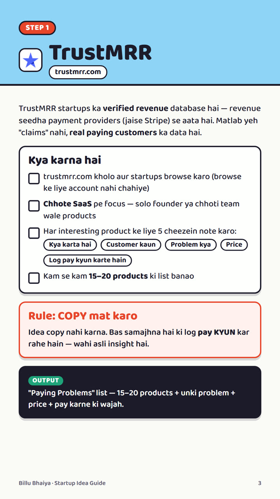
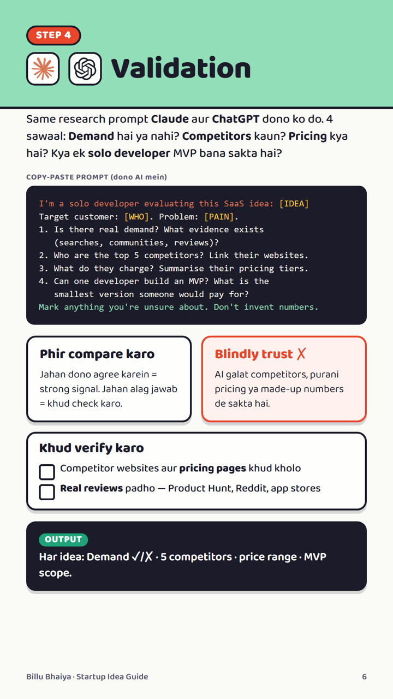
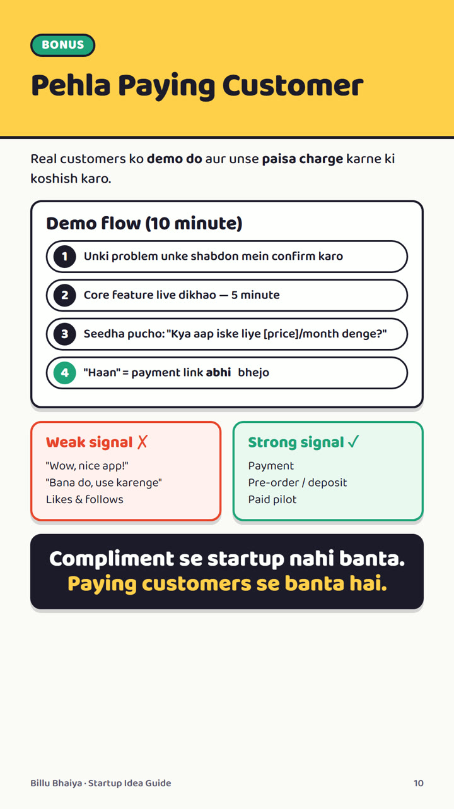

# Startup Idea se Paying Customer tak · Billu Bhaiya

**Mera 7-step process — pehle market, phir code.**

  

## 📄 Guide

- **[Open the PDF](Billu-Bhaiya-Startup-Idea-Guide.pdf)** (11 pages, phone-friendly)
- **[Web version](https://rupakghosh4865.github.io/startup-idea-guide/)** (read online or download)

## 7 steps, ek nazar mein

| # | Step | Kya milta hai |
| --- | --- | --- |
| 1 | **TrustMRR** | Kaun se chhote SaaS already paying customers se kama rahe hain |
| 2 | **Product Hunt** | Negative reviews = next opportunity |
| 3 | **IdeaBrowser** | Niche ideas (list mein hona ≠ profitable) |
| 4 | **Validation** | Claude + ChatGPT se research, phir khud verify |
| 5 | **Market Gap** | Competitors kahan fail ho rahe hain → wahi gap = tumhara product |
| 6 | **Claude Code** | Public user journey → `SPEC.md` |
| 7 | **Build** | Sirf 1 core feature wala MVP |
| ₹ | **Bonus** | Pehla paying customer + paid pilot |

## Preview

  
  
  

---

Compliment se startup nahi banta. **Paying customers se banta hai.** Chalo, build karte hain! 🚀

Tools ke features aur pricing badalte rehte hain — latest info unki official websites pe check karo.
